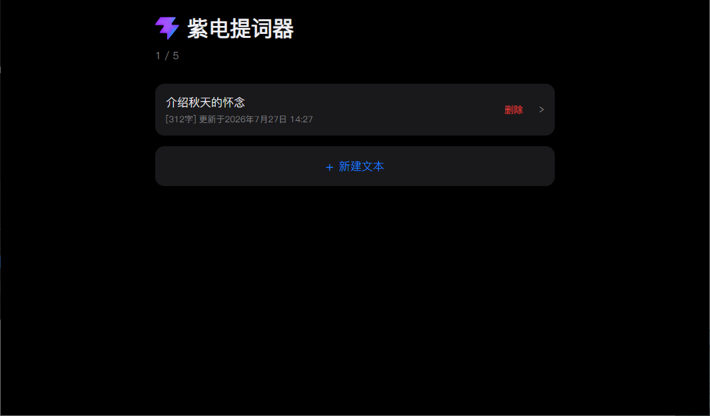
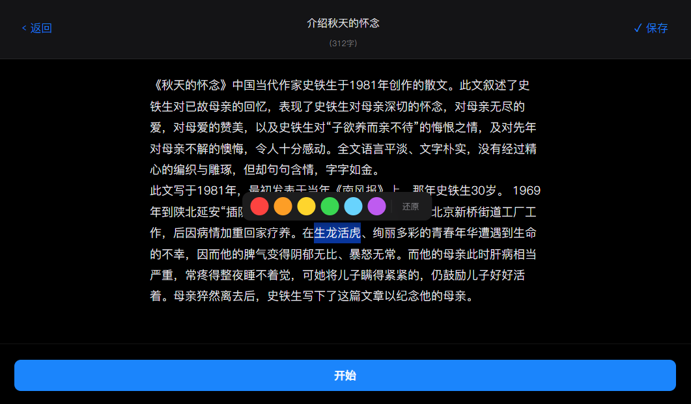
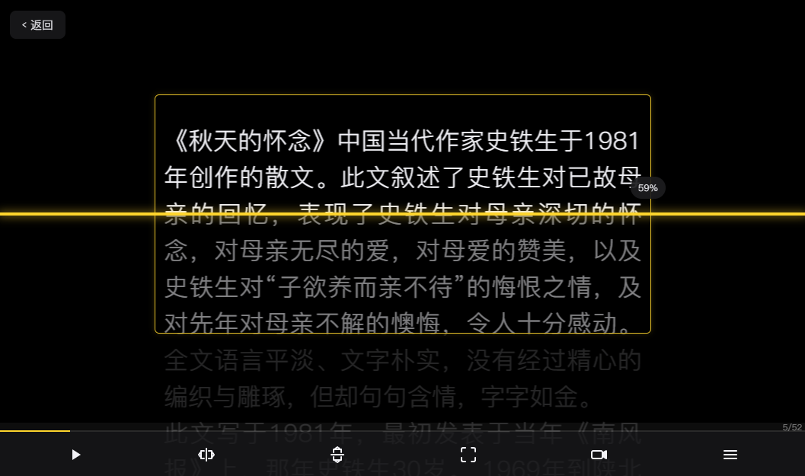
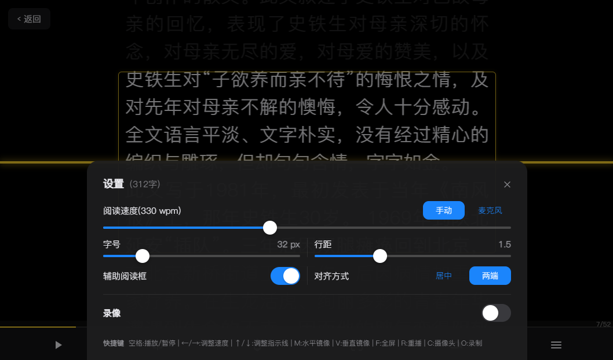
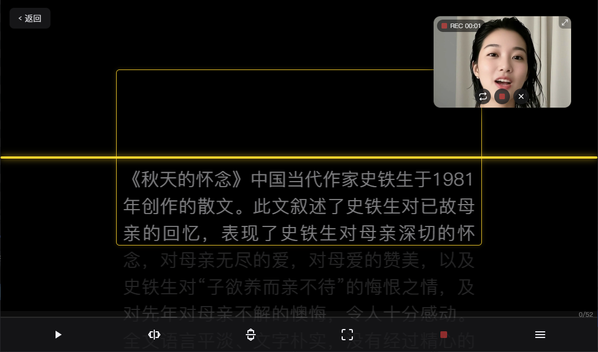
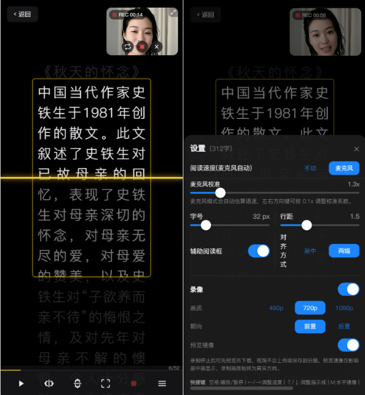

# 紫电提词器

紫电提词器是一款基于 React + Vite 的本地化网页提词器，面向演讲、直播、录课、短视频口播等场景。项目采用 Apple 风格的深色玻璃拟态界面，支持富文本编辑、播放页实时滚动、辅助阅读框、镜像显示、麦克风自动语速、摄像头画中画录制和移动端触摸调节。

## 功能特性

- **本地文本管理**：文本保存在浏览器 `localStorage`，默认最多保存 5 篇。
- **富文本编辑**：支持选中文字后设置颜色，粘贴网页内容时自动清理背景色、字号、字体和行高。
- **播放控制**：支持开始/暂停、重置、进度条拖动、鼠标滚轮调节进度、移动端触摸上下拖动调节进度。
- **语速设置**：支持手动 WPM 语速，也支持麦克风模式按朗读速度自动滚动，并提供校准系数。
- **阅读辅助**：支持辅助阅读框、阅读框宽度拖拽、阅读框高度拖拽、指示线位置调整。
- **显示适配**：支持水平镜像、垂直镜像、全屏播放、居中/两端对齐、字号和行距调节。
- **摄像头画中画**：支持开启摄像头浮窗预览，可拖拽移动、缩放、镜像显示，支持前后摄像头切换。
- **视频录制**：支持在提词过程中同步录制摄像头画面，录制完成后可预览和下载，视频不上传云端。
- **Apple 风格交互**：内置自定义确认/提示弹窗，避免浏览器原生 `alert` / `confirm` 破坏视觉一致性。

## DEMO

<table>
  <tr>
    <td align="center">
      <br>
      <b>列表</b>
    </td>
    <td align="center">
      <br>
      <b>编辑</b>
    </td>
    <td align="center">
      <br>
      <b>主页面</b>
    </td>
  </tr>
  <tr>
    <td align="center">
      <br>
      <b>设置</b>
    </td>
    <td align="center">
      <br>
      <b>开启录像</b>
    </td>
    <td align="center">
      <br>
      <b>移动端</b>
    </td>
  </tr>
</table>

## 技术栈

- React 19
- Vite 8
- JavaScript / JSX
- CSS 变量 + 内联样式
- 浏览器 `localStorage`、Selection API、Pointer Events、Web Audio API、MediaRecorder API

## 快速开始

```bash
npm install
npm run dev
```

构建生产版本：

```bash
npm run build
```

本地预览构建产物：

```bash
npm run preview
```

代码检查：

```bash
npm run lint
```

## 目录结构

```text
public/
  favicon.svg              # 首页 Logo / 浏览器图标
src/
  components/              # 通用组件：控制栏、滑杆、弹窗、颜色浮层、摄像头预览等
  config/                  # 默认设置和可调限制
  hooks/                   # 播放、全屏、键盘、麦克风语速、摄像头、录制等 Hook
  store/                   # 全局设置状态和持久化
  styles/                  # 全局样式与 Apple 风格基础类
  utils/                   # 文本存储、富文本处理、字数统计、录制兼容性检测
  views/                   # 首页、编辑页、播放页
```

## 关键配置

配置集中在 `src/config/settingsDefaults.js`。

### `SETTINGS_DEFAULTS`

| 变量 | 默认值 | 说明 |
| --- | --- | --- |
| `speed` | `290` | 手动模式默认阅读速度，单位 WPM。 |
| `speedMode` | `'manual'` | 默认语速模式，`manual` 为手动，`mic` 为麦克风自动。 |
| `micSpeedFactor` | `1.0` | 麦克风自动语速校准系数。 |
| `fontSize` | `32` | 播放页默认字号，单位 px。 |
| `lineHeight` | `1.5` | 播放页默认行高倍数。 |
| `width` | `40` | 文本/辅助阅读框默认宽度百分比。 |
| `focusGuideHeight` | `30` | 辅助阅读框默认高度百分比。 |
| `align` | `'center'` | 文本对齐方式，支持 `center` 和 `justify`。 |
| `mirrorH` | `false` | 是否默认水平镜像。 |
| `mirrorV` | `false` | 是否默认垂直镜像。 |
| `indicatorMode` | `'free'` | 指示线模式预留字段。 |
| `indicatorPos` | `50` | 指示线默认垂直位置百分比。 |
| `focusGuideEnabled` | `true` | 是否默认开启辅助阅读框。 |
| `cameraEnabled` | `false` | 是否默认开启摄像头。 |
| `cameraFacing` | `'user'` | 摄像头朝向，`user` 前置 / `environment` 后置。 |
| `cameraDeviceId` | `null` | 指定摄像头设备 ID（桌面端多摄像头选择）。 |
| `cameraResolution` | `720` | 录制分辨率，支持 480 / 720 / 1080。 |
| `pipPosition` | `{ xRatio: 0.985, yRatio: 0.88 }` | 画中画浮窗位置（相对比例）。 |
| `pipScale` | `1.0` | 画中画浮窗缩放倍数。 |
| `pipMirror` | `true` | 画中画预览是否镜像显示。 |

### `SETTINGS_LIMITS`

| 变量 | 范围 / 步进 | 说明 |
| --- | --- | --- |
| `speed` | `60`–`720`，步进 `5` | 手动阅读速度范围。 |
| `micSpeedFactor` | `0.5`–`5.0`，步进 `0.1` | 麦克风速度校准范围。 |
| `fontSize` | `16`–`96`，步进 `2` | 播放页字号范围。 |
| `lineHeight` | `1.0`–`2.5`，步进 `0.1` | 播放页行高范围。 |
| `width` | `20`–`100`，步进 `5` | 文本显示宽度范围，可在播放页拖拽调整。 |
| `indicatorPos` | `10`–`90`，步进 `1` | 指示线垂直位置范围。 |
| `focusGuideHeight` | `6`–`50`，步进 `1` | 辅助阅读框高度范围。 |
| `pipScale` | `0.25`–`2.5`，步进 `0.05` | 画中画浮窗缩放范围。 |

### `APP_LIMITS`

| 变量 | 默认值 | 说明 |
| --- | --- | --- |
| `maxTexts` | `5` | 本地最多保存的文本数量。 |

## 快捷键

| 快捷键 | 功能 |
| --- | --- |
| `Space` | 开始 / 暂停播放 |
| `←` / `→` | 手动模式调节阅读速度；麦克风模式调节校准系数 |
| `↑` / `↓` | 调整指示线位置 |
| `M` | 水平镜像开关 |
| `V` | 垂直镜像开关 |
| `F` | 全屏开关 |
| `R` | 重置播放进度 |
| `C` | 开启/关闭摄像头 |
| `O` | 开始/停止录制 |
| `Esc` | 退出全屏或返回上一页 |

## 使用说明

1. 在首页点击"新建文本"。
2. 在编辑页输入或粘贴提词内容，可选中文字设置强调颜色。
3. 点击"开始"进入播放页。
4. 在播放页使用空格控制播放，或打开设置调整语速、字号、行距、辅助阅读框和对齐方式。
5. 在播放页可直接拖拽辅助阅读框左右边缘调整宽度，也可拖拽上下边缘调整高度。
6. 按 `C` 或点击控制栏摄像头按钮开启画中画预览，按 `O` 开始录制，录制完成后可预览和下载视频。

## 数据与隐私

- 文本内容和设置均保存在当前浏览器本地。
- 项目不上传文本内容到服务器。
- 麦克风模式只在浏览器端分析音量和节奏，用于估算朗读速度。
- 录制的视频仅保存在浏览器内存中，下载后保存到本地，不经过任何云端服务。

## 浏览器兼容

建议使用最新版 Chrome、Edge、Safari 或 Firefox。

- 麦克风自动语速依赖浏览器权限和 Web Audio API；如果浏览器不支持或拒绝权限，会回退显示错误提示。
- 摄像头录制依赖 MediaRecorder API；Safari 14.5+ 支持，不支持的浏览器会提示"当前浏览器不支持录制"。
- 全屏和触摸交互已针对 Safari / iOS 做兼容适配。

## 开发备注

- 文本存储逻辑位于 `src/utils/textStore.js`。
- 富文本清洗和颜色处理位于 `src/utils/richtext.js`。
- 播放滚动核心逻辑位于 `src/hooks/useTeleprompter.js`。
- 摄像头管理位于 `src/hooks/useCamera.js`，录制逻辑位于 `src/hooks/useMediaRecorder.js`。
- 画中画浮窗组件位于 `src/components/CameraPreview.jsx`，支持拖拽定位和缩放。
- 播放页移动端连续拖动使用 Pointer Events，避免 `touchmove` passive listener 导致的卡顿。
